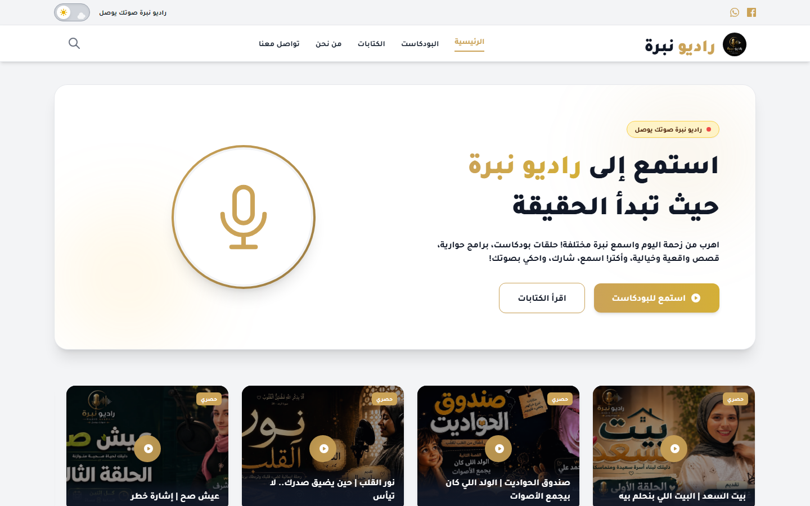
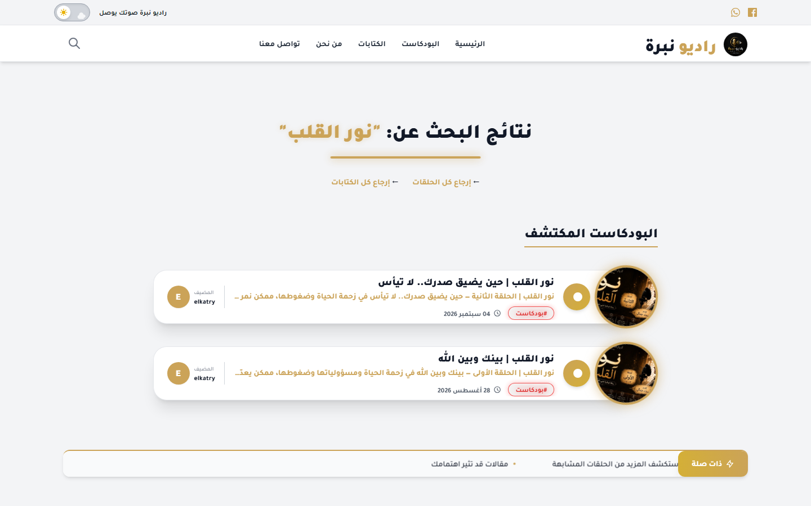
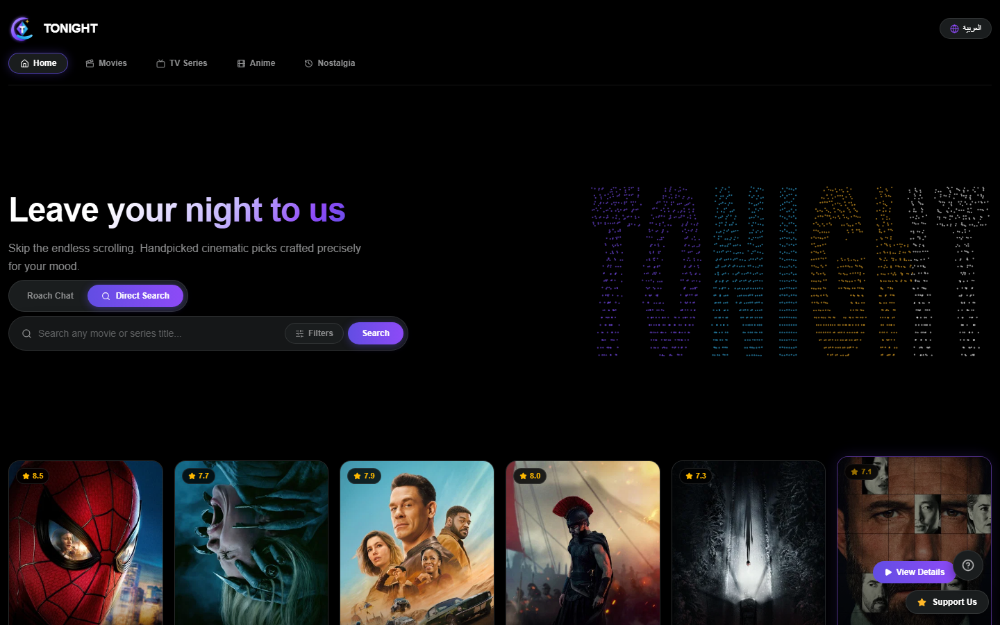
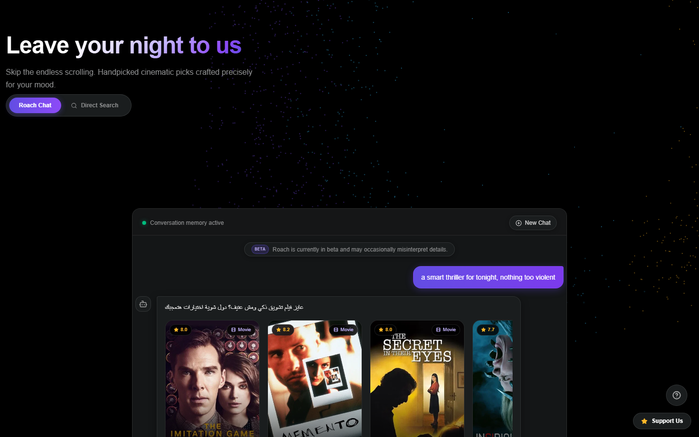
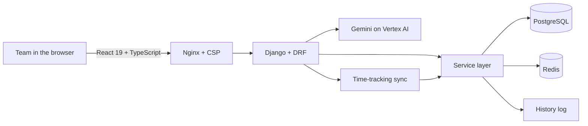
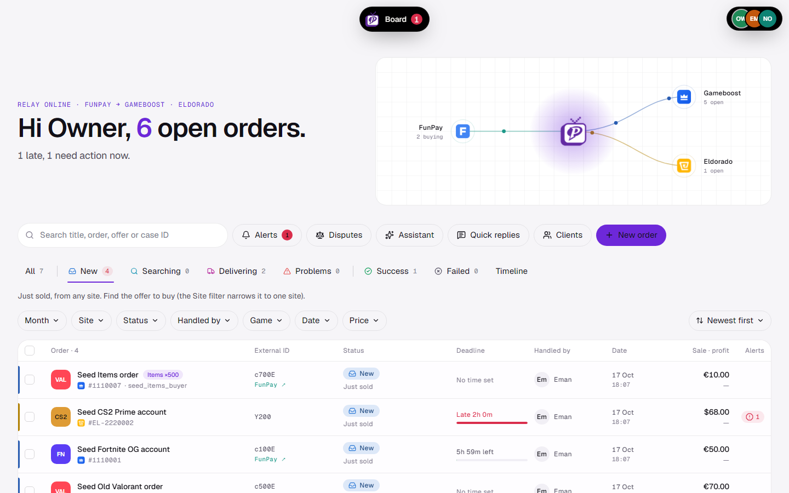
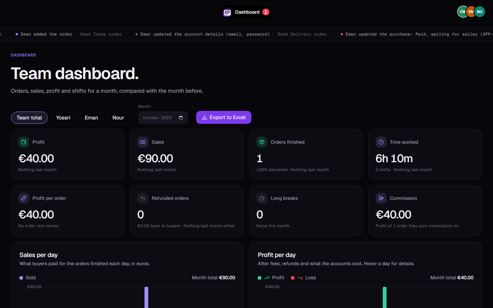
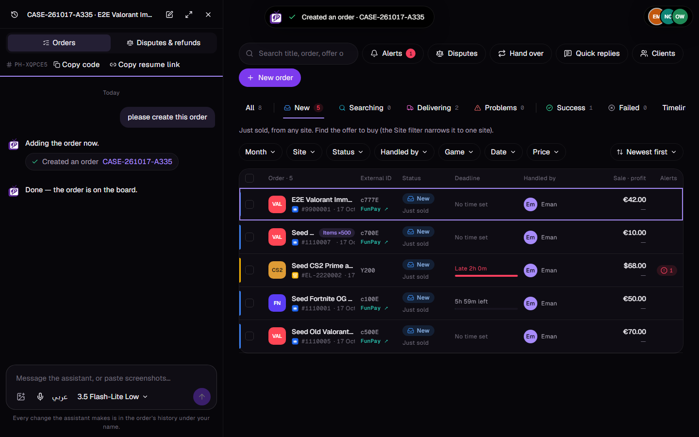

 

## About me

I build backend systems and the products on top of them. I take a project from the first data model to the Linux server it runs on: the Django API, the database, the React interface, the Nginx and Cloudflare setup, and the tests that keep all of it honest.

- I work **solo end to end** on production projects for real companies and real teams.
- I write **service-layer code with tests**, and I check query counts so a page does not quietly turn into 300 SQL calls.
- I treat **security as part of the build**: login lockout, strict headers and CSP, input hardening, secrets kept out of git.
- I use **AI tools in my workflow** and I also **build AI features**: LLM chat that calls tools over real data, with model and cost control.

 

## Stack

 

 

| Area | What I use |
| :-- | :-- |
| **Backend** | Python, Django, Django REST Framework, service layers, background jobs, REST design |
| **Data** | PostgreSQL (tuning, indexes, query audits), Redis caching, SQLite for local work |
| **Frontend** | React, TypeScript, Vite, TanStack Query, Tailwind CSS, Django templates |
| **Infrastructure** | Linux VPS, Nginx reverse proxy, Gunicorn, Cloudflare (DNS, SSL, security), Docker basics |
| **AI** | Gemini and Groq APIs, tool calling, prompt and model design, provider fallback |
| **Quality** | Django test suites, Playwright end-to-end, N+1 audits, security review |

 

## Featured projects

### [RadioNabra](https://radionabra.com): articles and audio streaming platform

> **Role:** Solo backend and infrastructure lead, end-to-end delivery &nbsp;·&nbsp; **Repository:** private, commercial client project

A production platform for publishing cultural articles and streaming podcasts, built for availability, security and an easy back office.

- **Core:** the data layer, business logic and API endpoints in **Python and Django**.
- **Database:** a secured **PostgreSQL** production instance with strict `.env` isolation.
- **Deployment:** **Linux VPS** with **Gunicorn** behind an **Nginx** reverse proxy.
- **Security and uptime:** **Cloudflare** for DNS, SSL termination and traffic filtering, keeping the platform at 99.9% uptime.
- **Back office:** a custom `django-unfold` dashboard so the content team can publish without a developer.
- **Front end:** the backend connected to the template layer, with responsive pages on mobile.

<table>
<tr>
<td width="50%"></td>
<td width="50%"></td>
</tr>
<tr>
<td align="center">Home page</td>
<td align="center">Search results</td>
</tr>
</table>

 

 

### Tonight: AI movie and TV discovery &nbsp;`in progress`

> **Role:** Solo full-stack developer &nbsp;·&nbsp; **Status:** close to release

Helps you decide what to watch tonight, by browsing or by talking to an AI assistant.

- **Data:** the **TMDB** API behind Django endpoints for discovery, search and details, cached in **Redis**.
- **AI chat:** **Groq** and **Gemini** with fallback between providers. It understands what you do not want, supports regenerate, and works in Arabic and English.
- **Learning loop:** every chat turn is logged with provider, latency and regenerate signal, so the prompts improve from real usage.
- **Interface:** **React 19, Vite and Tailwind** with an animated cinematic background, a chat assistant and a details modal.

<table>
<tr>
<td width="50%"></td>
<td width="50%"></td>
</tr>
<tr>
<td align="center">Home page</td>
<td align="center">Roach, the AI chat bot, recommending movies</td>
</tr>
</table>

 

 

### PlayerHub: order tracking and operations platform

> **Role:** Backend and full-stack developer &nbsp;·&nbsp; **Repository:** private, built for a company

A team uses it every day to follow digital-goods orders from the first message to delivery. Profit, shifts, seller performance and disputes live in one place instead of five spreadsheets and a chat app.

<table>
<tr>
<td width="50%" valign="top">

**Backend**
- Django 6 and DRF on PostgreSQL with Redis caching
- Every write goes through a service layer that records a history entry, and deletes are soft
- Per-order fee and profit breakdown by marketplace
- A 30-minute seller edit window, then manager approval
- Time-tracking sync that starts, pauses and ends shifts automatically
- Encrypted credentials vault

</td>
<td width="50%" valign="top">

**Frontend and AI**
- React 19 and TypeScript with TanStack Query
- Live order board, drawers, voice notes and a chat for each order
- Gemini on Vertex AI with selectable models and thinking levels
- Tool calling over the team's own data, plus a separate assistant for disputes
- Seller dashboards and a monthly Excel report
- Guided rules tour covering ten marketplaces

</td>
</tr>
</table>

**Numbers:** 600+ backend tests, 100+ Playwright end-to-end tests, and query-count tests that keep N+1 queries out.

<table>
<tr>
<td width="50%"></td>
<td width="50%"></td>
</tr>
<tr>
<td align="center">The live order board</td>
<td align="center">Team dashboard in the dark theme</td>
</tr>
<tr>
<td colspan="2"></td>
</tr>
<tr>
<td colspan="2" align="center">The AI assistant creating an order from a chat message, with the board updating beside it</td>
</tr>
</table>

The screenshots use demo data, not real orders, and the assistant answer in the screenshot is a scripted test reply.

 

## How I work

| | |
| :-- | :-- |
| **Simple first** | The smallest version that works end to end, then layers on top of it. |
| **Tested** | A change is finished when the tests pass, not when it compiles. |
| **Measured** | I look at query counts and bundle sizes before I call something fast. |
| **Safe by default** | Secrets in `.env`, hardened inputs, strict headers, rate limits on login. |
| **Readable** | Code that the next person can follow without asking me. |

 

## Activity

 

